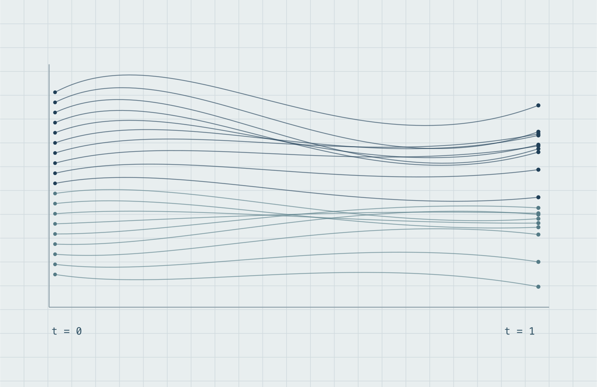

# Bruce Zhu

我关注计算机视觉与机器学习，近期的阅读围绕视觉表征、生成模型和长尾学习展开。

[阅读研究笔记](notes/index.md) · [GitHub](https://github.com/Bruce-Zhu-1)

## 精选笔记

### [Vision Transformer](notes/vision-transformer.md)

把一张图像写成 token 序列之后，Transformer 怎样学到可用于分类的视觉表征？

### [Flow Matching](notes/flow-matching.md)

从噪声到样本的路径怎样定义，速度场如何拟合，采样时又如何积分？

### [DALL·E 2](notes/dalle-2.md)

CLIP 图像表征如何连接文本条件与扩散解码器？

## 研究专题

### [CLIP × Flow](projects/clip-flow.md)

从冻结表征与线性探针出发，思考如何用对照实验区分分类头的收益与表征适配的收益。
