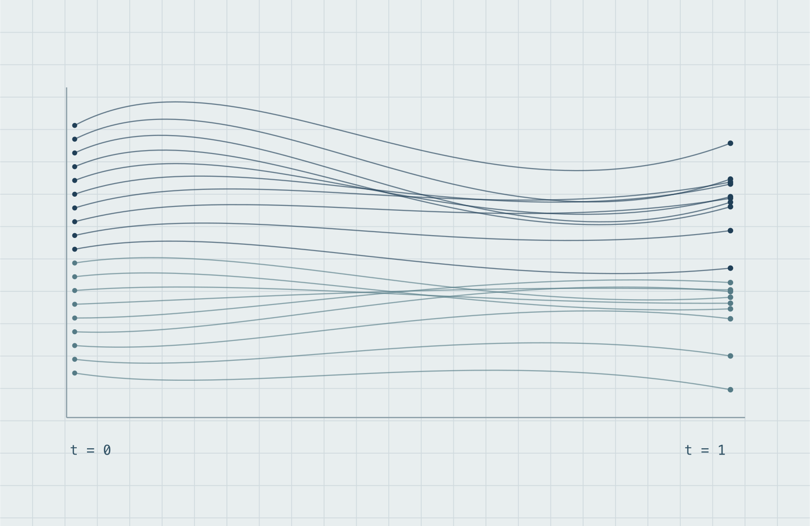

[Lipman 等，Flow Matching for Generative Modeling，ICLR 2023](https://arxiv.org/abs/2210.02747)

## 路径与速度

从一个简单的基分布采样 $x_0$，从数据分布采样 $x_1$。一个便于理解的例子是线性插值：

$$
x_t=(1-t)x_0+t x_1,\qquad \frac{\mathrm{d}x_t}{\mathrm{d}t}=x_1-x_0.
$$

端点的配对方式和路径选择会影响中间分布。上式给出的是一对端点的条件速度。回归得到的边缘速度场则在给定位置与时间上综合了可能经过此处的条件轨迹。

## 训练与采样

训练时随机采样时间 $t$，在中间点上回归已知的条件目标速度。采样时从基分布起点出发，沿学习到的速度场求解常微分方程。速度场的拟合误差和积分器的离散误差都会影响结果。

## 阅读延伸

对比不同路径时，记录端点配对、积分步数和计算预算。一个简单的消融是固定训练配置，只改变求解器的步长，分别比较采样质量与开销。
